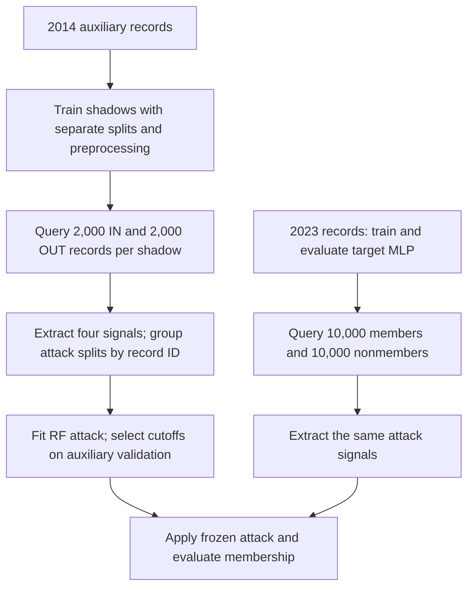
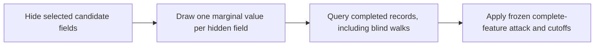
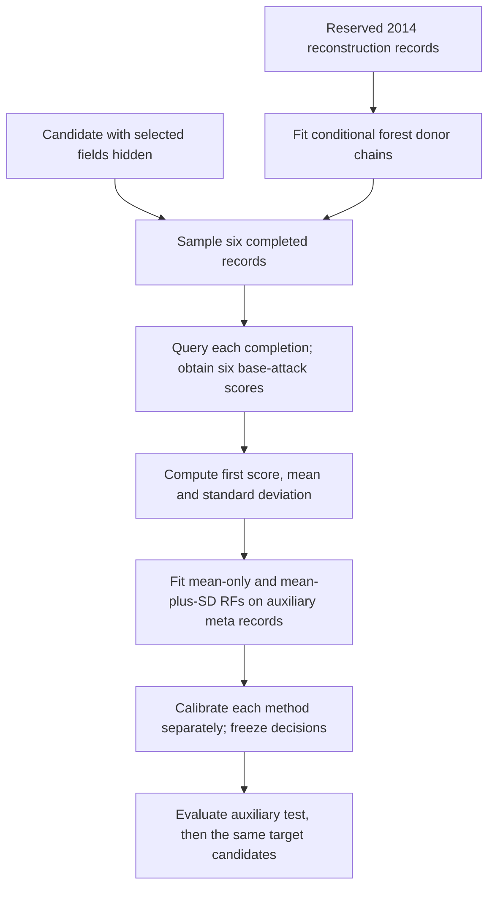
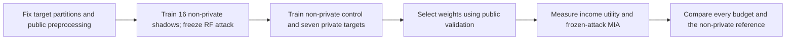

# Uncertainty-Aware Membership Inference and Differential Privacy

This project studies whether missing input features protect a person's training membership, whether uncertainty across reconstructed inputs helps an attacker, and how differential privacy changes the privacy-utility trade-off.

The experiments use California ACS data to predict whether personal income exceeds **$50,000**. They adapt my proposal to a 48-feature tabular setting. The explanations below follow the project methodology report, with results checked against the saved experiment files.

## Main notebooks

| Notebook | Study |
| --- | --- |
| [Experiment 3: missing-feature MIA](exp_3_expanded_missing_feature_baseline_mlp.ipynb) | Complete-feature MIA, PFV reconstruction and uncertainty-aware MF-MIA; 20 shadows |
| [Experiment 4: differential privacy](exp_4_differential_privacy_accuracy.ipynb) | Income-model utility and complete-feature MIA across privacy budgets; 16 shadows |

Earlier variants are in [`other experiments/`](other%20experiments/). The two notebooks above are the current entry points. Archived notebooks also assume that their kernel's working directory is the project root.

## Data and evaluation setting

Both main studies use **ACS 2023 as the target source** and **ACS 2014 as auxiliary information**. Income labels use nominal dollars, without inflation adjustment. Income amounts, survey weights and record identifiers are excluded from the predictors.

| Partition | Records | Purpose |
| --- | ---: | --- |
| Target training | 100,000 | Fit the income model |
| Target validation | 10,000 | Monitor training; select weights in Experiment 4 |
| Target utility test | 10,000 | Evaluate income prediction |
| MIA members | 10,000 | Subset of target training records |
| MIA nonmembers | 10,000 | Separate records outside target training |

The reference split sizes and seed are stored in [`data/reference_split_config.json`](data/reference_split_config.json). MIA members are part of the 100,000 training records, not an additional training partition.

### Attacker assumptions

- The attacker has **black-box probability access**: it knows the API input schema and class order and receives both income-class probabilities. A local query wrapper simulates this API.
- It knows the candidate's visible features, which fields are hidden, and the true income class. It does not know training membership or the actual hidden values.
- It can train shadows using auxiliary data and knows their IN/OUT labels. In Experiment 3, the four MLP shadows additionally assume knowledge of the target architecture and training recipe. The attack does not access target weights, gradients or private preprocessing statistics.
- Repeated queries and perturbed inputs are allowed. API costs, rate limits, probability rounding and plausibility restrictions are not simulated.

Target membership labels are used to evaluate attacks, not to fit them or select their cutoffs. Income labels are used for the attack's loss feature, not to condition missing-feature reconstruction.

### Target and shadow settings

| Setting | Experiment 3 | Experiment 4 |
| --- | --- | --- |
| Target hidden layers | 512 / 256 / 128, ReLU | 512 / 256 / 128, ReLU |
| Target training | 100 fixed epochs; final weights | Maximum 30 epochs; patience 5; restore selected weights |
| Target dropout / weight decay | 0 / 0 | 0.1 / 0.0001 |
| Target Adam learning rate | 0.001 | 0.0003 |
| Target batch size | 256 | Logical 256; private physical cap 32 |
| Shadows | 6 RF + 5 gradient boosting + 5 XGBoost + 4 MLP | 4 of each algorithm |
| MLP shadows | Target recipe, including 100 fixed epochs; distinct seeds | 128 / 64 layers; maximum 50 epochs; validation-loss early stopping, patience 5 |

Trees use the same settings in both studies: RF has 200 trees and minimum leaf size 2; gradient boosting has 300 trees, depth 3 and learning rate 0.05; XGBoost has 300 trees, depth 5 and learning rate 0.05. The Experiment 4 MLP shadows have zero dropout, learning rate 0.001 and weight decay 0.0001.

Every shadow gets a separately seeded **40% train / 20% validation / 40% OUT** split. Each fits imputation, scaling and encoding on its training split only. Records may be reused across shadows. Matching hidden-layer architecture does not require identical encoded input widths or training sizes.

Experiment 3 fits target preprocessing on target training records. Experiment 4 instead fits shared target preprocessing on **10,000 public 2014 records**, leaving the remaining **173,941** auxiliary records for shadows. Its target validation records are also assumed public and outside protected training data.

## 1. Complete-feature MIA

### Methodology

A trained model can respond differently to members and nonmembers, for example through loss, confidence or prediction stability. Shadows supply examples with known membership. A separate random forest learns to predict membership from those responses and is transferred to the target.

The four attack signals are **true-class log-probability ratio, entropy, cross-entropy loss and blind-walk stability**. The blind-walk feature measures the first step at which a perturbation changes the original predicted class, averaged over two walks of at most 20 steps.

### Pipeline



The attack uses approximately 60/20/20 train/validation/test groups. Repeated record IDs stay in one group across all shadows. The accuracy cutoff maximizes balanced accuracy on auxiliary validation; a separate cutoff targets at most 1% auxiliary-validation FPR.

For example, an income response `[0.12, 0.88]` supplies confidence and loss signals. The RF converts the signals into a separate membership score. The income probability **0.88 is not itself a membership probability**.

### Saved Experiment 3 results

| Evaluation | MIA accuracy | AUC | TPR at 1% FPR |
| --- | ---: | ---: | ---: |
| Auxiliary attack test | 53.826% | 0.5638 | 2.36% |
| Target, complete features | 62.725% | 0.6816 | 2.55% |

The target's income accuracy is **99.849% on training records and 79.52% on test records**, a 20.329-percentage-point gap. At the MIA accuracy cutoff, target TPR is 87.80% and FPR is 62.35%. The 62.725% accuracy should therefore be read alongside AUC and low-FPR performance.

These figures belong to the current **20-shadow** configuration. The historical 62.625% result belongs to the earlier tree-only experiment.

## 2. Missing-feature PFV baseline

### Methodology and pipeline

PFV draws each hidden field independently from its empirical 2014 frequency distribution. It does not condition on the candidate's visible features. Observed fields are preserved, and naturally missing donor values are excluded.



For example, if weekly hours are hidden, PFV may draw 20 hours from the overall auxiliary distribution regardless of the candidate's age or occupation. Neither the target nor the attack is retrained for a mask.

### Saved results

| Hidden fields | MIA accuracy | AUC | TPR at 1% FPR |
| --- | ---: | ---: | ---: |
| None: complete features | 62.725% | 0.6816 | 2.55% |
| MAR | 61.485% | 0.6652 | 2.34% |
| WKHP | 59.710% | 0.6356 | 1.81% |
| MAR + COW | 60.605% | 0.6507 | 1.86% |
| COW + SEX | 60.160% | 0.6443 | 2.14% |
| MAR + WKHP + SEX | 58.405% | 0.6168 | 1.60% |
| WKHP + COW + SEX | 57.930% | 0.6100 | 2.18% |
| MAR + WKHP + COW + SEX | 57.280% | 0.6013 | 1.43% |

MAR is marital status; WKHP is weekly working hours; COW is worker class; SEX is the dataset sex code. Seven preselected masks cover one to four missing fields. Related predictors remain visible, so hiding a field does not remove all information about it.

## 3. Uncertainty-aware MF-MIA

### Methodology

Conditional reconstruction uses visible features to generate **K = 6** plausible completions per candidate. Random-forest leaves provide donor values; for multiple hidden fields, later fields also condition on earlier sampled fields. This is an approximate predictive distribution, not a calibrated posterior.

Each completion produces a frozen-base-attack score. The study asks whether the scores' population standard deviation adds membership information beyond their mean.

### Pipeline



Reconstruction training excludes all base-attack, meta-fit, calibration and auxiliary-test candidate IDs. Auxiliary validation IDs are divided into meta-fit and calibration groups. Target membership labels do not choose reconstruction settings, masks, methods or thresholds.

The four controls use identical conditional draws: **one draw**, **average score**, **RF(mean)** and **RF(mean, SD)**. PFV is a separate marginal reconstruction baseline using the full eligible 2014 donor pool.

For illustration, six scores `[0.48, 0.49, 0.50, 0.50, 0.51, 0.52]` have mean 0.50 and SD about 0.013. Scores `[0.20, 0.20, 0.20, 0.80, 0.80, 0.80]` have the same mean but SD 0.30. The uncertainty RF can distinguish them only if auxiliary data support a relationship between variability and membership. These are explanatory examples, not measured candidate scores.

### Saved target results: equal-weight averages across seven masks

| Decision method | MIA accuracy | AUC | TPR at 1% FPR |
| --- | ---: | ---: | ---: |
| One conditional draw | 59.441% | 0.6311 | 1.85% |
| Average of six scores | 61.246% | 0.6506 | 2.27% |
| RF(mean) | 59.672% | 0.6336 | 1.95% |
| RF(mean, SD) | 60.087% | 0.6365 | 2.07% |

Adding SD improves average accuracy over the matched mean-only RF by **0.415 percentage points**, but direct averaging performs better than both learned RFs. This is exploratory evidence of a small benefit within the matched RF comparison, not proof of a reliable improvement over all baselines. These averages summarize different masks on the same candidates, not independent repeat runs.

## 4. Differential privacy: utility and membership leakage

### Methodology and pipeline

Experiment 4 trains fresh private and non-private targets on the same partitions. Opacus clips per-record gradients and adds Gaussian noise before Adam updates, with Poisson sampling and RDP accounting. The requested budgets are **epsilon = 0.5, 1, 2, 5, 10, 25, 50**, with **delta = 0.000001** fixed.



Public-validation accuracy selects target weights, with lower loss breaking exact ties. Noise is calibrated for the full 30-epoch maximum before training. The reported privacy guarantee uses that **fixed-schedule bound**; epsilon at the actual stopping time is a diagnostic, not a tighter adaptive-stopping claim.

All shadows are non-private, and one attack and its auxiliary-selected cutoffs stay fixed across the sweep. This evaluates transfer to DP targets; it does not train a separate DP-adapted attack per budget. No features are masked and no reconstruction is performed in this experiment.

### Latest saved accuracy sweep

| Requested epsilon | Income test accuracy | MIA accuracy | MIA AUC | TPR at 1% FPR |
| --- | ---: | ---: | ---: | ---: |
| Non-private | 81.76% | 51.315% | 0.5202 | 0.81% |
| 0.5 | 79.88% | 50.385% | 0.5034 | 0.83% |
| 1 | 79.96% | 50.240% | 0.5024 | 0.88% |
| 2 | 80.30% | 49.995% | 0.4995 | 1.01% |
| 5 | 80.83% | 50.355% | 0.5050 | 1.09% |
| 10 | 80.83% | 49.455% | 0.4974 | 1.00% |
| 25 | 80.96% | 50.390% | 0.5068 | 1.11% |
| 50 | 81.40% | 49.780% | 0.5007 | 1.05% |

At epsilon 1, income prediction is 79.96% accurate while membership prediction is 50.240% accurate. These measure different tasks. The MIA set is balanced, so 50% accuracy is a chance reference; AUC 0.5 indicates random ranking. The auxiliary attack test AUC is only **0.5135**, and even the non-private target's attack accuracy is close to chance. These results do not establish resistance to stronger attacks.

The plots use equally spaced epsilon categories and a horizontal non-private reference. The income-accuracy y-axis is **70-90%** and the MIA-accuracy y-axis is **40-60%**. Empirical accuracy need not increase monotonically with epsilon in individual stochastic runs.

## Running the notebooks

Use Python 3.12 and run commands from the project root. In Windows PowerShell:

```powershell
py -3.12 -m venv .venv
.\.venv\Scripts\python.exe -m pip install -r requirements.txt
.\.venv\Scripts\python.exe -m ipykernel install --user --name mf-mia --display-name "Python (MF-MIA)"
```

The main notebooks require these raw California ACS files:

```text
data/raw/folktables/2014/1-Year/ss14pca.csv
data/raw/folktables/2023/1-Year/psam_p06.csv
```

If the datasets are absent, the project downloader can fetch them:

```powershell
.\.venv\Scripts\python.exe scripts/download_data.py --state CA --year 2014
.\.venv\Scripts\python.exe scripts/download_data.py --state CA --year 2023
```

Open a main notebook in VS Code, select the `Python (MF-MIA)` kernel and run cells in order from the project root when ready to start the experiment. Training and completion queries can take hours on a laptop. Both notebooks keep models and completion draws in memory; they do not save model checkpoints or logs. Restarting the kernel requires recomputation.

## Files and saved results

```text
MF-MIA/
|-- exp_3_expanded_missing_feature_baseline_mlp.ipynb
|-- exp_4_differential_privacy_accuracy.ipynb
|-- other experiments/       Earlier notebook variants
|-- src/                     Data, training, attack and DP helpers
|-- scripts/                 Dataset and notebook utilities
|-- tests/                   Helper validation
|-- data/                    Raw datasets and reference split configuration
|-- artifacts/               Metrics, protocols, split IDs, scores and graphs
|-- requirements.txt
`-- AGENTS.md                Rules for agent-assisted experiment execution
```

The metric tables above are a saved-results snapshot, checked on **19 November 2026**. Their local source folders are:

- Experiment 3: `artifacts/exp_3_2023_2014_100000_nominal_tree16_mlp4_target_recipe/reduced_k6_s20_m7/`. Read `summary.json`, `missing_feature_pfv/comparison.csv` and `uncertainty_mf_mia/comparison.csv`.
- Experiment 4: `artifacts/exp_4_2023_2014_dp_accuracy_e0p5_1_2_5_10_25_50_d1e6_mixed_mlp/`. Read `protocol.json`, `auxiliary_attack_metrics.csv` and `dp_target_and_mia_metrics.csv`.

Raw/processed datasets, the virtual environment and artifacts are excluded from Git. Saved notebook outputs and these tables provide a readable snapshot; local result files support further analysis. Preserve those files before rerunning because the same output paths are reused. Earlier model checkpoints and completion caches were removed to reduce storage.

## Limitations

1. **Attack strength and false positives.** The DP attack transfers weakly. Experiment 3's higher accuracy also comes with many false positives. Neither result establishes the strongest possible membership attack.
2. **Low-FPR reporting.** TPR at 1% FPR in the tables comes from the evaluation ROC. The separate auxiliary-selected cutoff does not guarantee 1% target FPR: actual private-target FPR is 8.64-11.84% in the latest DP sweep.
3. **Data and masking.** The sources differ by year, income is not inflation-adjusted, masks are artificial and related proxy features remain visible. Disjoint year-qualified record IDs do not prove person-level independence.
4. **Reconstruction and perturbations.** Conditional forests provide approximate completions, and six draws give a noisy SD estimate. Blind walks add finite-sampling variability. Experiment 3 retains categorical shadow perturbations but numeric target perturbations for JWMNP/JWRIP; Experiment 4 uses consistent rules.
5. **Repeatability and cost.** These are exploratory configurations with one overall seed and separately seeded shadows. Private noise is independently sampled. Repeated whole-experiment runs have not established confidence intervals for the reported differences.
6. **Privacy scope.** The DP claim is record-level and per model, conditional on fixed public preprocessing/validation data and partitions. Releasing multiple models requires privacy composition. Evaluation statistics are not DP-sanitized, and `secure_mode=False` is a research randomness setting.

## Future work

The combined **uncertainty-aware missing-feature attack against DP targets has not been evaluated**. The next study would apply the same masks and conditional controls to each private target and its non-private comparison. Further work includes repeated training runs, stronger attacks adapted to DP targets, and better calibration of low-FPR decisions under distribution shift.
